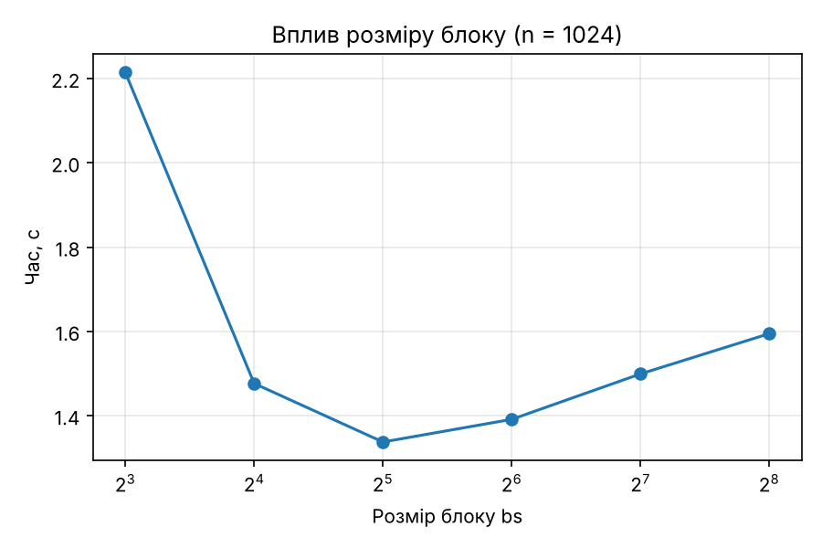
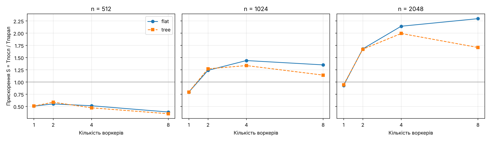
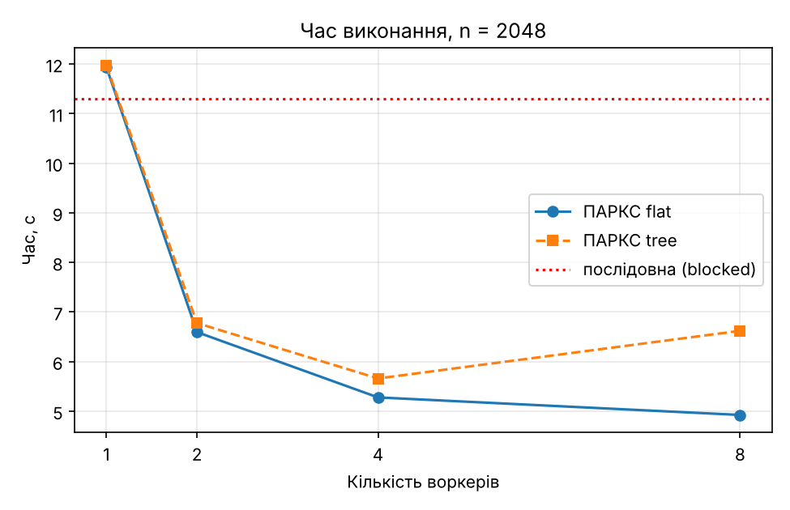

# Звіт про тестування: паралельне множення матриць (блочний алгоритм) на ПАРКС-Java

Усі числа нижче — з файлів `results/cloud_seq.csv` та `results/cloud_results.csv` (виміряно в Google Cloud). Таблиці та графіки згенеровано скриптом `tools/report_tables.py`; у таблицях — **медіана трьох повторів**.

## 1. Умови експерименту

| Параметр | Значення |
|---|---|
| Провайдер / регіон | Google Cloud Platform, europe-north1-b |
| Машини | 4 VM `e2-medium` (2 vCPU, спільні ядра): `hosts-server`, `daemon-1`, `daemon-2`, `app` |
| Вузлів-обчислювачів | 2 (`daemon-1`, `daemon-2`), разом 4 vCPU |
| ОС / Java | Debian 12 / OpenJDK 17 |
| Платформа | ПАРКС-Java (HostsServer + Daemon), модель КП «Дерево» |
| Дані | матриці n × n з цілих 0..9, seed = 1; B передається транспонованою |
| Розмір блоку | bs = 64 (паралельні тести) |
| Розміри n | 512, 1024, 2048 |
| Режими КП | flat (зірка, сітка gr × gc), tree (бінарне дерево) |
| Воркерів | 1, 2, 4, 8 |
| Повторів | 3 |
| Процесор | _вставте рядок `Model name` з виводу `lscpu` (скриншот)_ |

Прискорення S = Tпосл / Tпарал, ефективність E = S / p. Tпосл — час блокового ядра на VM `app` одним потоком у тому ж запуску; Tпарал — повний час від початку розсилання даних до отримання повної матриці C (серіалізація, передача, обчислення, повернення результату). Коректність: паралельний результат збігається з послідовним **побітово** — у всіх **72 з 72** запусків `correct=true`.

## 2. Послідовні версії

### 2.1 Наївний і блоковий алгоритми

| n | naive, с | blocked (bs=64), с | Прискорення blocked/naive |
|---:|---:|---:|---:|
| 512 | 0.451 | 0.189 | 2.4 |
| 1024 | 5.087 | 1.391 | 3.7 |

Блоковий алгоритм швидший за наївний у 2,4 раза при n = 512 та у 3,7 раза при n = 1024, причому розрив росте з розміром матриці: чим більша матриця, тим гірше наївний цикл, що читає B за стовпцями, працює з кешем. Для n = 2048 наївний алгоритм не вимірювали (надто повільний); блоковий потребує ≈ 11,1 с.

### 2.2 Вплив розміру блоку (n = 1024)

| Розмір блоку bs | Час, с |
|---:|---:|
| 8 | 2.214 |
| 16 | 1.476 |
| 32 | 1.337 |
| 64 | 1.391 |
| 128 | 1.499 |
| 256 | 1.595 |

Найкращий результат — при bs = 32 (1,34 с), bs = 64 дає майже те саме (1,39 с). Дуже малі блоки (bs = 8) повільніші в 1,7 раза: плитки замалі, цикли мають великі накладні витрати і дані слабо перевикористовуються. При великих блоках (128, 256) час повільно зростає, бо плитки перестають вміщуватися в швидкі рівні кешу. Для паралельних тестів узято bs = 64, що лежить поруч з оптимумом.

## 3. Паралельна версія, режим `flat`

| n | Воркерів | Час ПАРКС, с | Час послід., с | S | E | Коректно |
|---:|---:|---:|---:|---:|---:|:--:|
| 512 | 1 | 0.380 | 0.192 | 0.51 | 0.51 | так |
| 512 | 2 | 0.343 | 0.189 | 0.55 | 0.28 | так |
| 512 | 4 | 0.392 | 0.201 | 0.51 | 0.13 | так |
| 512 | 8 | 0.570 | 0.219 | 0.39 | 0.05 | так |
| 1024 | 1 | 1.775 | 1.405 | 0.79 | 0.79 | так |
| 1024 | 2 | 1.130 | 1.400 | 1.24 | 0.62 | так |
| 1024 | 4 | 0.964 | 1.388 | 1.44 | 0.36 | так |
| 1024 | 8 | 1.027 | 1.386 | 1.35 | 0.17 | так |
| 2048 | 1 | 11.936 | 11.091 | 0.93 | 0.93 | так |
| 2048 | 2 | 6.594 | 11.070 | 1.68 | 0.84 | так |
| 2048 | 4 | 5.278 | 11.305 | 2.14 | 0.54 | так |
| 2048 | 8 | 4.924 | 11.309 | 2.30 | 0.29 | так |

## 4. Паралельна версія, режим `tree`

| n | Воркерів | Час ПАРКС, с | Час послід., с | S | E | Коректно |
|---:|---:|---:|---:|---:|---:|:--:|
| 512 | 1 | 0.374 | 0.189 | 0.51 | 0.51 | так |
| 512 | 2 | 0.317 | 0.186 | 0.59 | 0.29 | так |
| 512 | 4 | 0.396 | 0.187 | 0.47 | 0.12 | так |
| 512 | 8 | 0.535 | 0.187 | 0.35 | 0.04 | так |
| 1024 | 1 | 1.744 | 1.385 | 0.79 | 0.79 | так |
| 1024 | 2 | 1.117 | 1.419 | 1.27 | 0.63 | так |
| 1024 | 4 | 1.054 | 1.409 | 1.34 | 0.33 | так |
| 1024 | 8 | 1.230 | 1.403 | 1.14 | 0.14 | так |
| 2048 | 1 | 11.973 | 11.289 | 0.94 | 0.94 | так |
| 2048 | 2 | 6.777 | 11.321 | 1.67 | 0.84 | так |
| 2048 | 4 | 5.660 | 11.282 | 1.99 | 0.50 | так |
| 2048 | 8 | 6.621 | 11.300 | 1.71 | 0.21 | так |

## 5. Графіки

## 6. Аналіз

**1. Коректність.** Усі 72 паралельні запуски дали точно такий самий результат, як послідовне обчислення. Це забезпечено цілими елементами матриць (суми точні) і тим, що кожен воркер рахує свій блок C незалежно.

**2. Залежність від розміру матриці.** Паралельна версія виграє лише для досить великих n. При n = 512 вона **повільніша** за послідовну в усіх конфігураціях (S = 0,35–0,59): сама робота займає ≈ 0,19 с, а передача матриць і запуск точок коштує порівнянно. При n = 1024 прискорення з'являється (до 1,44), при n = 2048 досягає 2,30. Ефективність при p = 2 зростає з n: 0,28 → 0,62 → 0,84. Це підтверджує теоретичну оцінку (розд. 3.4 `algorithm_description.md`): обчислення ростуть як n³, а передача даних як n², тому частка комунікації падає з ростом n.

**3. Накладні витрати ПАРКС.** Навіть з одним воркером паралельна версія повільніша за послідовну: різниця Tпарал − Tпосл становить ≈ 0,19 с (n = 512), ≈ 0,37 с (n = 1024), ≈ 0,85 с (n = 2048). Це вартість запуску точки, серіалізації двох смуг матриці, передачі їх по мережі й повернення результату.

**4. Залежність від кількості воркерів.** Найкраще прискорення для n = 2048: S = 1,68 (p = 2), 2,14 (p = 4), 2,30 (p = 8) у режимі flat. Перехід від 2 до 4 воркерів дає ще +27 %, від 4 до 8 — лише +7 %: прискорення насичується. Причини: (а) обчислювальних ресурсів лише 4 vCPU (2 демони по 2 vCPU, до того ж спільні ядра e2-medium), тож 8 воркерів не можуть працювати по-справжньому паралельно; (б) корінь роздає й збирає дані послідовно, і цей обсяг роботи не зменшується при збільшенні p (за розрахунком з розд. 3.4, flat передає ≈ (gc + gr + 1)·n² чисел: 7n² при p = 8). Приблизна оцінка: якби обчислення ідеально розподілились на 4 vCPU, воно зайняло б ≈ 11,3 / 4 ≈ 2,8 с, а виміряно 4,9 с, тобто решта ≈ 2 с — комунікація й запуск точок (оцінка, не пряме вимірювання).

**5. flat проти tree.** При p ≤ 2 режими практично однакові (структура та сама). При p = 4 tree трохи гірший (n = 2048: 5,66 с проти 5,28 с), при p = 8 помітно гірший: 6,62 с проти 4,92 с (S = 1,71 проти 2,30), при n = 1024 — 1,23 с проти 1,03 с. Дерево створює 2p − 2 = 14 точок замість 8 і пересилає дані на кожному рівні (проміжні вузли отримують смуги, копіюють їх і розсилають далі); на двох демонах із 4 vCPU це лише додає навантаження. Головна перевага дерева — корінь надсилає всього 2 повідомлення — тут не проявляється, бо вузьке місце — **обсяг даних**, а не число повідомлень. Для даної задачі й кластера flat кращий.

**6. Розкид вимірювань.** Повтори в основному різняться менше ніж на 3–5 %. Помітніші відхилення: tree, n = 2048, p = 8 (6,62 / 6,72 / 5,80 с) і поодинокі «викиди» Tпосл (наприклад, 13,49 с замість ≈ 11,2 с в одному з запусків flat, n = 2048, p = 4). Це типово для віртуальних машин зі спільними ядрами, тому в таблицях використано медіану.

**7. Порівняння ефекту оптимізації й паралелізму.** При n = 1024 перехід від наївного до блокового алгоритму прискорив обчислення в 3,7 раза на одному ядрі, а паралельний запуск на двох вузлах дав лише 1,44. Тобто для цієї задачі оптимізація роботи з пам'яттю дала більше, ніж паралелізм на малому кластері.

## 7. Висновки

1. Реалізовано блоковий алгоритм множення матриць у ПАРКС-Java (модель КП «Дерево», режими flat і tree); паралельний результат збігається з послідовним у всіх 72 запусках.
2. Блокове множення швидше за наївне в 2,4–3,7 раза (n = 512…1024); оптимальний розмір блоку 32–64.
3. Найкраще прискорення на 2-вузловому кластері e2-medium — **S ≈ 2,30** (n = 2048, flat, 8 воркерів); при p = 2 ефективність 0,84.
4. Для малих матриць (n = 512) паралельна версія програє послідовній через вартість передачі даних; з ростом n прискорення зростає, що узгоджується з оцінкою «обчислення ~ n³, комунікація ~ n²».
5. Прискорення обмежене кількістю ядер (4 vCPU на двох вузлах) і послідовною роздачею даних із кореня; збільшення воркерів понад 4 майже нічого не дає.
6. Режим flat швидший за tree, особливо при p = 8, бо дерево пересилає більше даних і створює більше процесів.
7. Для подальшого дослідження: більше вузлів (демонів), більші n (напр. 4096, не перевірялось) та різні розміри блоків у паралельному режимі.
